<!-- ========================================== -->
<!-- 1. LIVE TELEMETRY HEATMAP                  -->
<!-- Auto-refreshed daily by GitHub Actions     -->
<!-- ========================================== -->

<h3><code>aryamehr@github ~ $ ./telemetry-heatmap.sh</code></h3>

 
 

<!-- ========================================== -->
<!-- 2. DUAL-PANE TERMINAL INTERFACE           -->
<!-- Left: Self-typing ASCII Portrait           -->
<!-- Right: Fastfetch / Neofetch Info Card      -->
<!-- ========================================== -->

<h3><code>aryamehr@github ~ $ whoami</code></h3>

<table>
  <tr>
    <td valign="top">
      
    </td>
    <td valign="top">
      
    </td>
  </tr>
</table>

 
 

<!-- ========================================== -->
<!-- 3. CONNECT & REPOSITORIES                  -->
<!-- ========================================== -->

<h3><code>aryamehr@github ~ $ ./links.sh</code></h3>

  <b>Full-Stack Software Architect · Computer & Aerospace Engineering @ Sharif University of Technology</b>

  
  
  
  

 

