

<a href="https://github.com/AryaMehr-Nam">
  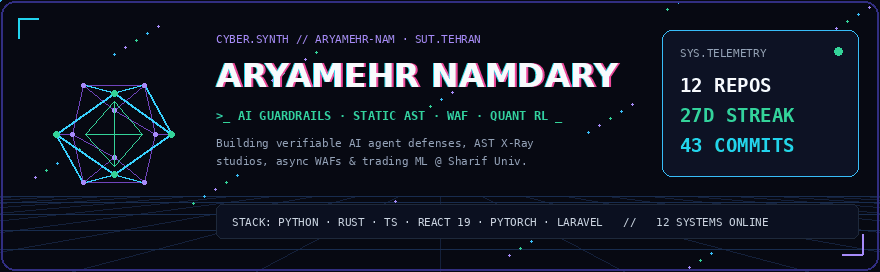
</a>

 


  


 

<table>
  <tr>
    <td width="50%" align="center">
       
      <a href="https://github.com/AryaMehr-Nam/CodeAtlas">
        
      </a>
    </td>
    <td width="50%" align="center">
       
      <a href="https://github.com/AryaMehr-Nam/A11yPilot">
        
      </a>
    </td>
  </tr>
  <tr>
    <td width="50%" align="center">
      <a href="https://github.com/AryaMehr-Nam/SentinelX-Platform">
        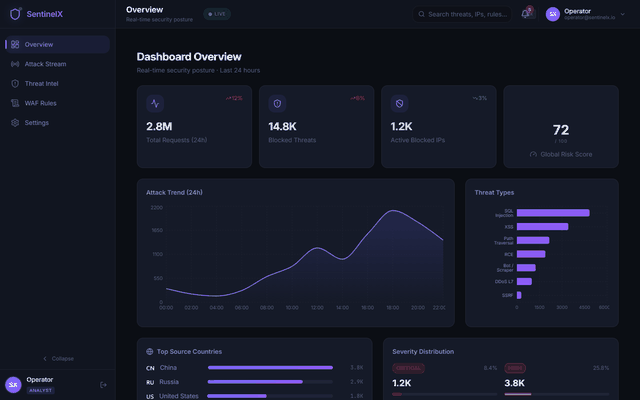
      </a> 
      <a href="https://github.com/AryaMehr-Nam/SentinelX-Platform">
        
      </a>
    </td>
    <td width="50%" align="center">
       
      <a href="https://github.com/AryaMehr-Nam/agent-redline">
        
      </a>
    </td>
  </tr>
</table>

 


 

<table>
  <tr>
    <td width="50%" align="center">
      <a href="https://github.com/AryaMehr-Nam/mcp-guard">
        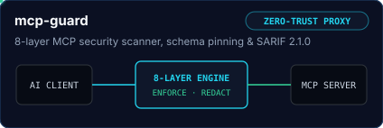
      </a>
    </td>
    <td width="50%" align="center">
      <a href="https://github.com/AryaMehr-Nam/Autonomous-Trading-Framework">
        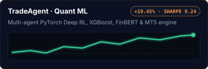
      </a>
    </td>
  </tr>
  <tr>
    <td width="50%" align="center">
      <a href="https://github.com/AryaMehr-Nam/laravel-spec-skill">
        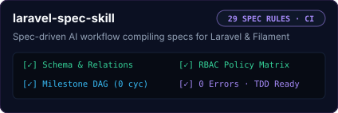
      </a>
    </td>
    <td width="50%" align="center">
      <a href="https://github.com/AryaMehr-Nam/Aether-Tray">
        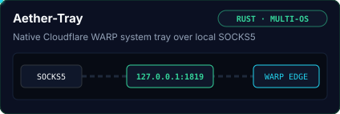
      </a>
    </td>
  </tr>
</table>

 


 


  

<code>05 // ADDITIONAL UTILITIES &amp; TOOLS (3 MORE REPOS)</code>

 

- **[Arya-MultiThread-Downloader](https://github.com/AryaMehr-Nam/Arya-MultiThread-Downloader)** — Segmented multi-threaded HTTP download manager with dynamic chunk stitching & live bandwidth monitoring (`Python` · `Tkinter`)
- **[Sample-DirBuster](https://github.com/AryaMehr-Nam/Sample-DirBuster)** — Concurrent web directory & file reconnaissance scanner with status filtering (`Python` · `Security`)
- **[Virtual-Webcam-Mouse](https://github.com/AryaMehr-Nam/Virtual-Webcam-Mouse)** — Real-time hand-gesture cursor control pipeline (`MediaPipe` · `OpenCV`)

 

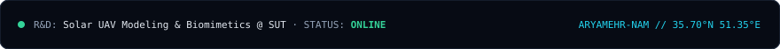

  
  

