<picture>
  <source media="(prefers-color-scheme: dark)" srcset="./header-dark.svg">
  <source media="(prefers-color-scheme: light)" srcset="./header-light.svg">
  
</picture>

#### `02 //` SELECTED SYSTEMS &amp; BENCHMARKS

| System | Architecture & Scope | Verified Proof |
| :--- | :--- | :--- |
| **[SentinelX-Platform](https://github.com/AryaMehr-Nam/SentinelX-Platform)** | Async ASGI WAF engine, multi-provider AI threat analysis, React 19 SOC dashboard & Manifest V3 extension (`SecureLens`) | **CI + Trivy** · 25 Tests |
| **[agent-redline](https://github.com/AryaMehr-Nam/agent-redline)** | Deterministic zero-dependency AST pre-tool firewall & prompt-injection guard for Antigravity, Claude Code, Cursor & Codex | **100% Recall** · 0.82ms |
| **[Autonomous-Trading-Framework](https://github.com/AryaMehr-Nam/Autonomous-Trading-Framework)** | Multi-market quant framework combining Transformers, XGBoost, Deep RL, FinBERT news sentiment & MT5 execution | **+19.45%** · Sharpe 9.24 |
| **[laravel-spec-skill](https://github.com/AryaMehr-Nam/laravel-spec-skill)** | Spec-driven Agent Skill turning plain-language requirements into validated JSON specs & TDD builds for Laravel 11/12 + Filament | **29 Spec Rules** · CI Pass |
| **[Aether-Tray](https://github.com/AryaMehr-Nam/Aether-Tray)** | Native cross-platform Rust system tray client for Cloudflare WARP (`Aether`) over local SOCKS5 with zero privilege escalation | **Rust** · Win / macOS / Linux |

#### `03 //` INTERFACE ARTIFACTS

<table>
  <tr>
    <td width="33%" align="center">
       
      <b>SentinelX</b> — Real-Time WAF &amp; SOC
    </td>
    <td width="33%" align="center">
       
      <b>agent-redline</b> — 335-Cmd Eval
    </td>
    <td width="33%" align="center">
       
      <b>laravel-spec-skill</b> — Spec Engine
    </td>
  </tr>
</table>

<code>04 //</code> Additional Utilities &amp; Research

 

- **[Arya-MultiThread-Downloader](https://github.com/AryaMehr-Nam/Arya-MultiThread-Downloader)** — Segmented multi-threaded HTTP download manager with dynamic chunk stitching and live bandwidth telemetry (`Python` · `Tkinter`).
- **[Sample-DirBuster](https://github.com/AryaMehr-Nam/Sample-DirBuster)** — Concurrent web directory and file reconnaissance scanner with status filtering (`Python` · `Security`).
- **[Virtual-Webcam-Mouse](https://github.com/AryaMehr-Nam/Virtual-Webcam-Mouse)** — Real-time hand-gesture cursor control pipeline (`MediaPipe` · `OpenCV`).
- **Academic R&amp;D:** Solar UAV Modeling &amp; Biomimetics @ Sharif University of Technology (`SUT`).

---

  <b>R&amp;D:</b> Solar UAV Modeling &amp; Biomimetics @ SUT &nbsp;·&nbsp; <b>Contact:</b> <a href="mailto:darklegend1380@gmail.com">darklegend1380@gmail.com</a> &nbsp;·&nbsp; <b>GitHub:</b> <a href="https://github.com/AryaMehr-Nam">AryaMehr-Nam</a>

